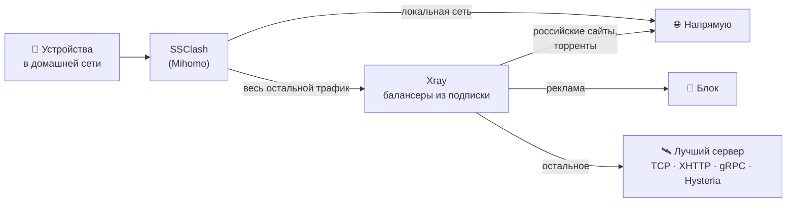

<div align="center">

# 🛰️ ConnectaRouter

**VPN на роутер OpenWrt одной командой — так же, как в Happ, только для всей домашней сети**


</div>

---

## ✨ Возможности

- ⚡ **Установка одной командой** — пакеты, SSClash, ядро Mihomo и Xray ставятся автоматически
- 🌀 **Балансеры из подписки** — роутер получает тот же Xray JSON, что и Happ: все хосты спрятаны за балансером и выбираются автоматически
- 🌍 **Выбор страны** — каждый балансер подписки (Германия, Нидерланды, Финляндия…) доступен отдельно в панели управления
- 🔀 **Раздельное туннелирование как в Happ** — российские сайты напрямую, остальное через VPN, реклама блокируется. Правила берутся из подписки и обновляются сами
- 🔄 **Автообновление** — подписка обновляется каждые 6 часов, новые страны появляются без перенастройки
- 📱 **Работает для всех устройств** — телевизоры, приставки, консоли и умный дом получают VPN без приложений
- 🧹 **Удаление одной командой**

---

## 🚀 Установка

Подключитесь к роутеру по SSH и выполните команду, подставив свою ссылку подписки:

```sh
wget -qO- https://raw.githubusercontent.com/Connecta-VPS/ConnectaRouter/main/install.sh | sh -s -- 'ССЫЛКА_ПОДПИСКИ'
```

Через пару минут в конце появится:

```
>>> Всё работает. IP через VPN: xxx.xxx.xxx.xxx
>>> Панель управления: http://192.168.1.1:9090/ui
```

<details>
<summary><b>📖 Как подключиться к роутеру по SSH</b></summary>

<br>

1. Подключите компьютер к роутеру по Wi-Fi или кабелем.
2. Откройте терминал:
   - **Windows** — `Win + R` → `powershell` → Enter
   - **macOS** — программа «Терминал»
3. Введите команду (адрес роутера может отличаться, например `192.168.0.1`):
   ```sh
   ssh root@192.168.1.1
   ```
4. Введите пароль от роутера — тот же, что от веб-интерфейса LuCI.
5. Когда появится строка `root@OpenWrt:~#`, вставьте команду установки.

</details>

---

## 🎛️ Управление

Откройте в браузере **`http://IP-роутера:9090/ui`**

| Группа | Что делает |
|---|---|
| 🛡️ **VPN** | Основная группа. По умолчанию — автовыбор лучшего сервера. Можно вручную выбрать страну |
| 📺 **Youtube** | Отдельный выбор страны для YouTube |

---

## 🛠️ Команды

| Действие | Команда |
|---|---|
| Сменить подписку | Запустить команду установки с новой ссылкой |
| Обновить подписку сейчас | `xray-sub-update.sh` |
| Список стран и портов | `cat /tmp/xray-sub/list.txt` |
| Проверить VPN | `curl -x socks5h://127.0.0.1:10808 https://ifconfig.me` |
| Логи | `logread \| grep xray` |
| Удалить | `wget -qO- https://raw.githubusercontent.com/Connecta-VPS/ConnectaRouter/main/install.sh \| sh -s -- uninstall` |

---

## ⚙️ Как это работает



1. **SSClash** перехватывает трафик всех устройств сети и передаёт его в Xray.
2. **Xray** работает с подпиской точно так же, как Happ: каждый балансер слушает свой порт (`10808`, `10809`…), сам проверяет хосты и выбирает самый быстрый.
3. Правила раздельного туннелирования берутся из Xray JSON подписки — при их изменении в панели роутеры подхватят новые правила автоматически.

---

## 📋 Требования

| Параметр | Требование |
|---|---|
| **Прошивка** | OpenWrt 23.05+ с firewall4 (поддерживаются `opkg` и `apk`) |
| **Память** | от 256 МБ RAM |
| **Флеш** | от 25 МБ свободного места |
| **Подписка** | Ссылка вида `https://subnecta.cc/AbCdEf123456` из личного кабинета — та же, что добавляется в Happ |

> 💡 Ссылку подписки вставляйте в команду установки целиком, в одинарных кавычках: `'https://subnecta.cc/AbCdEf123456'`

---

## ❓ Частые проблемы

<details>
<summary><b>Подписка не отдала Xray JSON</b></summary>

<br>

- Проверьте, что ссылка подписки скопирована полностью.
- Если в подписке включён лимит устройств — роутер считается отдельным устройством. Удалите лишнее устройство в личном кабинете.

</details>

<details>
<summary><b>Xray не принял конфиг</b></summary>

<br>

Причина записана в файле:

```sh
cat /tmp/xray-sub/test.log
```

Чаще всего помогает обновление `xray-core` до последней версии.

</details>

<details>
<summary><b>Сайты не открываются после установки</b></summary>

<br>

Перезапустите службы:

```sh
/etc/init.d/xray-sub restart && /etc/init.d/clash restart
```

Если не помогло — проверьте логи: `logread | grep -E "xray|clash"`.

</details>

---

<div align="center">

**Connecta VPS** · сделано для OpenWrt

<sub>Использует <a href="https://github.com/XTLS/Xray-core">Xray-core</a>, <a href="https://github.com/zerolabnet/ssclash">SSClash</a> и <a href="https://github.com/MetaCubeX/mihomo">Mihomo</a></sub>

</div>
